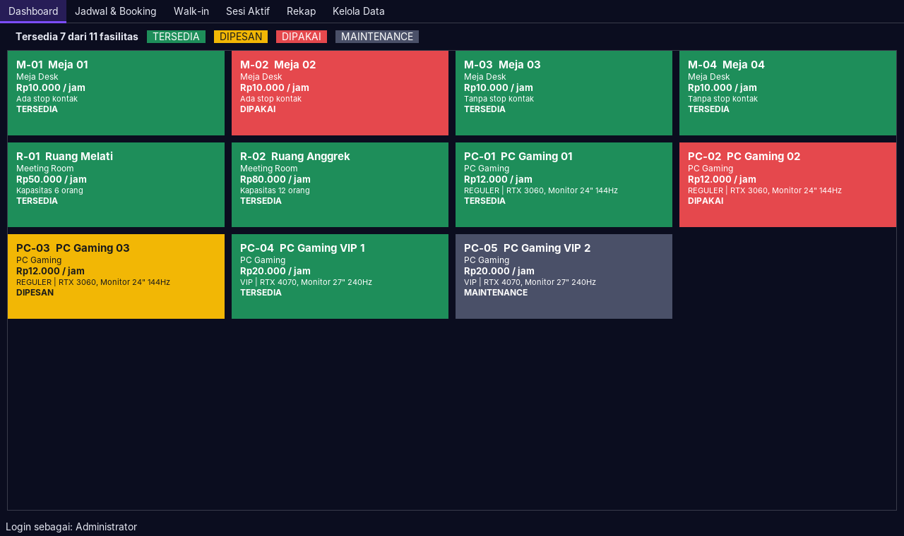
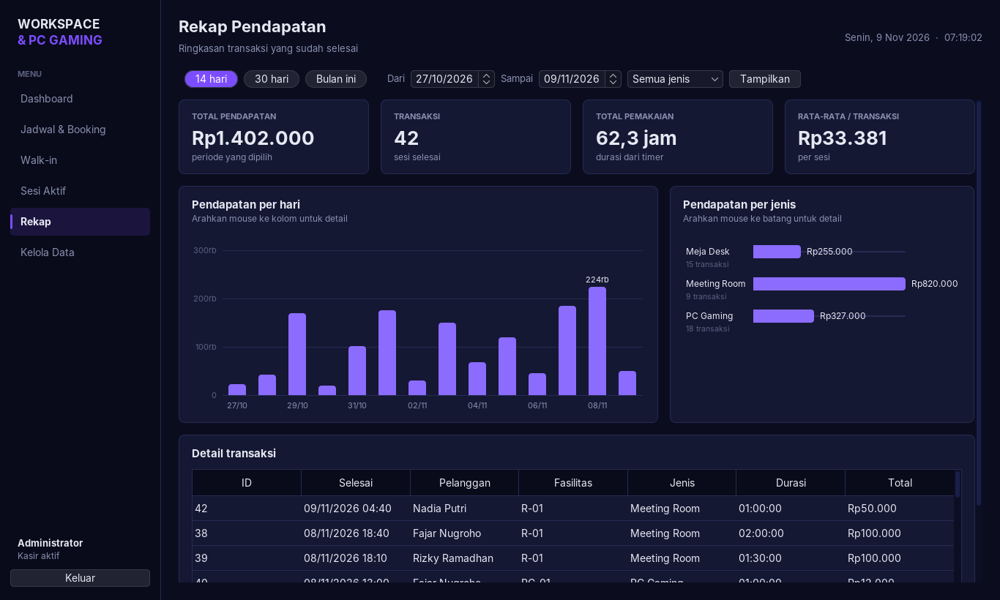
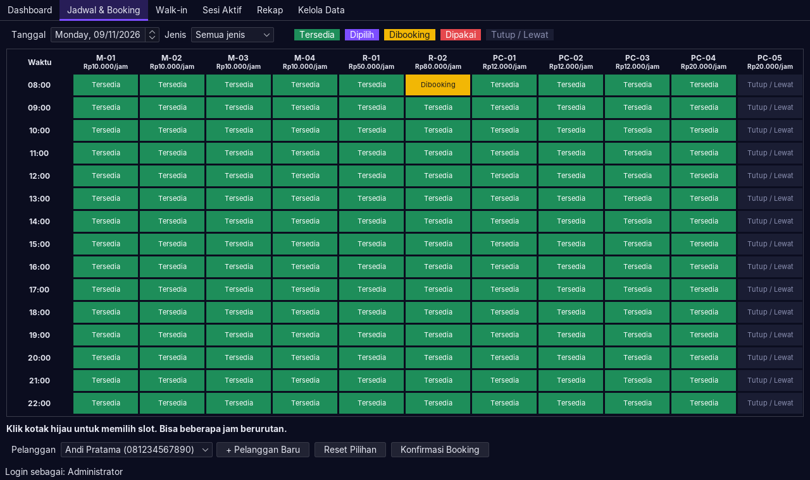
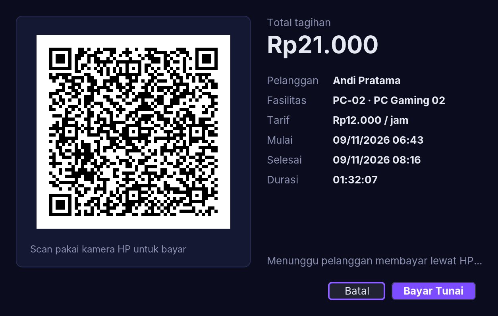
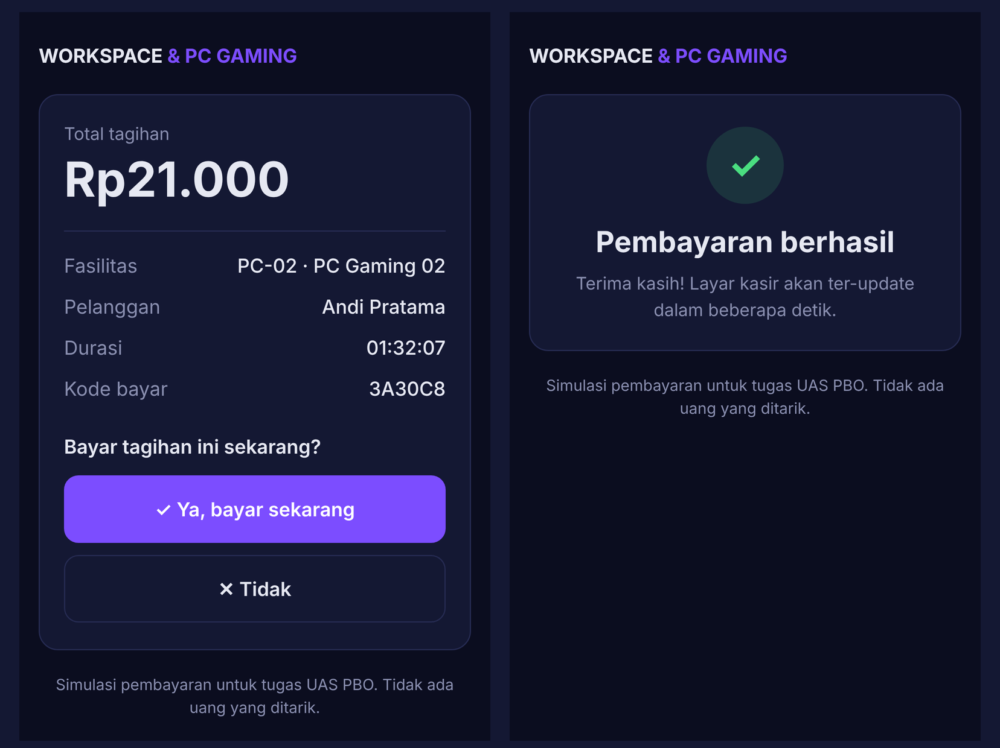

# Working Space & Rental PC Gaming

Aplikasi desktop **Java Swing + MySQL** untuk mengelola penyewaan meja kerja, ruang meeting, dan PC gaming.
Tugas UAS **Pemrograman Berorientasi Objek (SYS61516)**, Fakultas Ilmu Komputer, Universitas Singaperbangsa Karawang.

**Kelompok 8:** Salwa & Fathir



## Fitur

| Fitur | Keterangan |
|---|---|
| Login | Akun default `admin` / `admin123` |
| Dashboard real-time | Kartu tiap fasilitas berwarna sesuai status, diperbarui otomatis setiap 3 detik |
| Jadwal & Booking | Grid jadwal per jam (Tersedia / Dipilih / Dibooking / Dipakai / Tutup-Lewat). Pilih beberapa jam berurutan, lihat estimasi biaya, lalu konfirmasi |
| Walk-in | Pelanggan tanpa booking langsung main, timer langsung jalan |
| Timer durasi | Tab Sesi Aktif: check-in booking, durasi dan biaya berjalan setiap detik, struk saat selesai |
| Bayar via QR | Saat **Selesai & Bayar**, aplikasi menampilkan QR. Pelanggan scan pakai HP, menekan **Ya**, dan layar kasir ter-update sendiri. Bisa juga bayar tunai (simulasi, tanpa uang sungguhan) |
| Rekap + grafik | Angka ringkasan, grafik pendapatan per hari & per jenis (Java2D, ada tooltip saat mouse di atas batang), dan tabel detail |
| Kelola data | Tambah / ubah / hapus fasilitas dan pelanggan |
| Tampilan | Tema gelap ala gaming (FlatLaf + font Inter), menu samping, kartu dengan sudut bulat |





## Konsep OOP

Class abstrak **`Fasilitas`** diturunkan menjadi **`MejaDesk`**, **`MeetingRoom`**, dan **`PCGaming`**. Ketiganya punya tarif per jam dan aturan hitung biaya yang berbeda:

| Class | Tarif contoh | Aturan `hitungBiaya()` |
|---|---|---|
| `MejaDesk` | Rp10.000/jam | per 30 menit, dibulatkan ke atas |
| `MeetingRoom` | Rp50.000–80.000/jam | per jam penuh, minimal 1 jam |
| `PCGaming` | Rp12.000 (Reguler) / Rp20.000 (VIP) | per 15 menit, dibulatkan ke atas |

Biaya akhir selalu dihitung dari **timer** (check-in sampai selesai). Jadwal booking hanya untuk memesan tempat dan menampilkan estimasi.

Penjelasan lengkap ada di [docs/DESAIN.md](docs/DESAIN.md).

## Bayar via QR (simulasi)



1. Di **Sesi Aktif**, pilih sesi lalu klik **Selesai & Bayar**. Tagihan dibekukan (jam selesai = saat tombol diklik) dan QR muncul.
2. Pelanggan scan QR dengan kamera HP. Halaman [`web/bayar.html`](web/bayar.html) di Vercel terbuka dan menampilkan tagihan yang sama.
3. Pelanggan menekan **Ya, bayar sekarang** atau **Tidak**. Halaman mengirim jawabannya ke [ntfy.sh](https://ntfy.sh), layanan pesan gratis, dengan kode tagihan sebagai nama topik.
4. Aplikasi menanyakan topik itu ke ntfy.sh setiap 3 detik (`PembayaranQr`). Begitu jawabannya **Ya**, sesi selesai, unit kembali Tersedia, dan struk muncul.



Laptop kasir dan HP pelanggan butuh internet. Kalau internet mati, pakai tombol **Bayar Tunai**.
Ini simulasi untuk tugas, tidak ada uang yang ditarik. Di bisnis sungguhan, bagian ini diganti payment gateway QRIS resmi.

## Cara Menjalankan

### 1. Siapkan JDK 17 dan VS Code
- Install **JDK 17** atau lebih baru.
  - Windows: [Adoptium Temurin 17](https://adoptium.net)
  - Mac: `brew install openjdk@17`
- Di VS Code, install extension **Extension Pack for Java** (sudah termasuk dukungan Maven).

### 2. Siapkan MySQL

**Windows: XAMPP**
1. Install [XAMPP](https://www.apachefriends.org), buka XAMPP Control Panel, klik **Start** pada **MySQL** (dan Apache untuk phpMyAdmin).
2. Buka <http://localhost/phpmyadmin>, pilih tab **Import**, pilih file `database/workspace_db.sql`, klik **Go**.

**Mac: Homebrew** (XAMPP tidak tersedia untuk Mac)
```bash
brew install mysql
brew services start mysql
mysql -u root < database/workspace_db.sql
```
Untuk melihat isi tabel tanpa phpMyAdmin, pakai extension VS Code **"MySQL" (Weijan Chen)** atau aplikasi **DBeaver**.

> Kedua cara memakai setting yang sama: `localhost:3306`, user `root`, password kosong.
> Kalau setting kalian berbeda, ubah konstanta di `src/main/java/id/unsika/workspace/db/Koneksi.java`.

### 3. Jalankan aplikasi
- Buka folder project ini di VS Code, tunggu Maven selesai mengunduh dependency.
- Buka `src/main/java/id/unsika/workspace/App.java`, klik **Run**.
- Atau lewat terminal: `mvn compile exec:java`

### 4. Jalankan unit test
```bash
mvn test
```
Test di `src/test` membuktikan perhitungan biaya tiap jenis fasilitas, tagihan yang dibekukan saat bayar, dan cara aplikasi membaca jawaban dari HP pelanggan.

## Struktur Folder

```
src/main/java/id/unsika/workspace/
├── App.java            titik masuk program
├── model/              class OOP: Fasilitas, MejaDesk, MeetingRoom, PCGaming, Pelanggan, Pemesanan
├── db/Koneksi.java     koneksi MySQL (Singleton)
├── dao/                akses database (interface generik Dao<T>)
├── service/            logika pemesanan (pesan, check-in, selesai, batal) + PembayaranQr (cek status bayar QR)
├── ui/                 tampilan Java Swing (Login, Dashboard, Jadwal, Walk-in, Sesi Aktif, Dialog Bayar + QR, Rekap, Kelola Data, Tema)
└── util/Format.java    format Rupiah, durasi, tanggal
database/workspace_db.sql   struktur tabel + data contoh
docs/                       desain dan screenshot
web/                        showcase + halaman bayar QR (Vercel)
```
