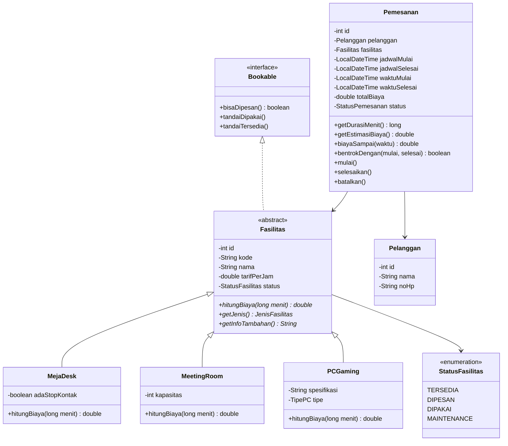
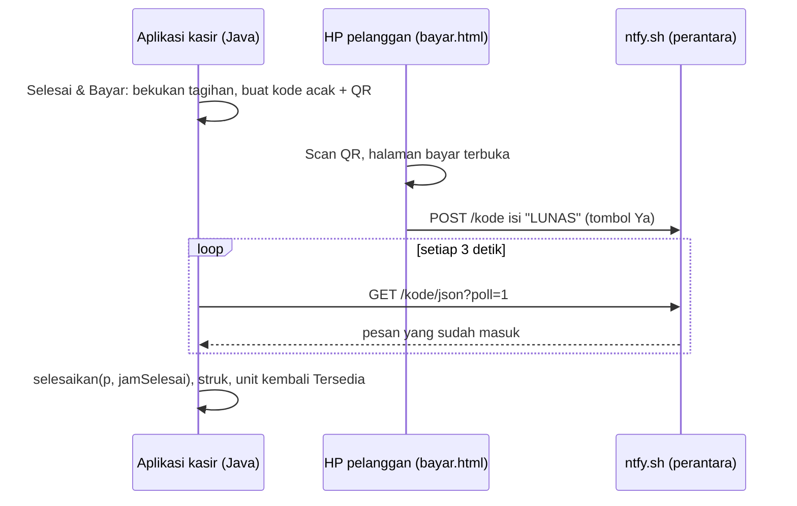

# Desain Aplikasi: Working Space & Rental PC Gaming

**UAS Pemrograman Berorientasi Objek (SYS61516), Fasilkom Unsika**
Kelompok: **Salwa & Fathir**
Teknologi: Java 17, Java Swing, MySQL (XAMPP), JDBC (`mysql-connector-j`), Maven

---

## 1. Gambaran Aplikasi

Aplikasi desktop untuk mengelola tempat **working space sekaligus rental PC gaming**. Pelanggan bisa menyewa tiga jenis fasilitas:

| Jenis | Contoh | Tarif/jam | Aturan khusus |
|---|---|---|---|
| **MejaDesk** (table) | Meja 01–10 | Rp10.000 | Dihitung per 30 menit |
| **MeetingRoom** (ruangan) | Ruang Melati, Ruang Anggrek | Rp50.000 (Melati), Rp80.000 (Anggrek) | Dihitung per jam penuh, minimal bayar 1 jam |
| **PCGaming** (monitor/PC) | PC-01–PC-08 | Rp12.000 (Reguler), Rp20.000 (VIP) | Dihitung per 15 menit |

Perbedaan cara menghitung biaya inilah yang menjadi inti **polymorphism**: semua fasilitas punya method `hitungBiaya(menit)`, tapi tiap jenis menghitung dengan caranya sendiri.

## 2. Fitur

1. **Login** (satu akun admin)
2. **Dashboard status real-time**: kartu tiap fasilitas berwarna hijau (Tersedia), merah (Dipakai), kuning (Dipesan), abu-abu (Maintenance). Timer di kartu berjalan tiap detik dan data dimuat ulang tiap 3 detik dengan `javax.swing.Timer`.
3. **Jadwal & Booking**: grid per jam (08:00–23:00) dengan status Tersedia / Dipilih / Dibooking / Dipakai / Tutup-Lewat. Kasir memilih beberapa jam berurutan pada satu fasilitas, melihat estimasi biaya, lalu konfirmasi.
3b. **Walk-in**: pelanggan tanpa booking langsung main, timer langsung jalan.
3c. **Tema gelap** ala gaming (library FlatLaf, warna navy `#0B0D1F` + aksen ungu `#7C4DFF`).
4. **Sesi aktif + timer durasi**: menampilkan durasi berjalan (jam:menit:detik) dan biaya sementara secara live. Tombol **Selesai & Bayar** membekukan tagihan, lalu setelah dibayar menghitung total dan mengembalikan status fasilitas ke Tersedia.
4b. **Bayar via QR (simulasi)**: dialog bayar menampilkan QR berisi link ke `web/bayar.html`. Pelanggan scan pakai HP dan menekan **Ya** atau **Tidak**; aplikasi mengecek jawabannya setiap 3 detik lewat perantara ntfy.sh dan langsung menyelesaikan sesi saat **Ya**. Tersedia juga tombol **Bayar Tunai**.
5. **Rekap**: daftar transaksi per tanggal/periode, filter per jenis fasilitas, total pendapatan, dan fasilitas paling laris.
6. **Kelola data**: tambah/ubah/hapus fasilitas dan pelanggan (CRUD).

## 3. Penerapan 4 Pilar OOP

| Pilar | Di mana |
|---|---|
| **Abstraction** | `Fasilitas` adalah *abstract class* dengan method abstrak `hitungBiaya()` dan `getJenis()`. Interface `Dapat Dipesan` (`Bookable`) mendefinisikan kontrak pemesanan. |
| **Inheritance** | `MejaDesk`, `MeetingRoom`, `PCGaming` *extends* `Fasilitas`. Panel GUI turunan dari `JPanel`, frame dari `JFrame`. |
| **Encapsulation** | Semua atribut `private`, diakses lewat getter/setter dengan validasi (mis. tarif tidak boleh negatif). |
| **Polymorphism** | `List<Fasilitas>` berisi campuran ketiga subclass; memanggil `f.hitungBiaya(menit)` otomatis memakai versi milik subclass-nya (*overriding*). |

Materi lain yang ikut dipakai (sesuai PDF kuliah): `ArrayList`, Generics (`Dao<T>`), for-each, enum, exception handling, dan *constructor overloading* (`Pemesanan` punya 3 constructor: walk-in, booking, dan data dari database).
Tambahan dari fitur bayar QR: thread terpisah dengan `SwingWorker` supaya tampilan tidak macet, dan HTTP client bawaan Java (`java.net.http.HttpClient`).

## 4. Class Diagram



## 5. Struktur Project (Maven)

```
src/main/java/id/unsika/workspace/
├── App.java                     # titik masuk program
├── model/                       # class OOP (inti penilaian)
│   ├── Bookable.java
│   ├── Fasilitas.java           # abstract
│   ├── MejaDesk.java
│   ├── MeetingRoom.java
│   ├── PCGaming.java
│   ├── Pelanggan.java
│   ├── Pemesanan.java
│   └── enums: StatusFasilitas, StatusPemesanan, JenisFasilitas, TipePC
├── db/
│   └── Koneksi.java             # koneksi MySQL (Singleton)
├── dao/                         # akses database
│   ├── Dao.java                 # interface generik Dao<T>
│   ├── FasilitasDao.java
│   ├── PelangganDao.java
│   └── PemesananDao.java
├── service/
│   ├── PemesananService.java    # logika mulai/selesai sesi, rekap
│   └── PembayaranQr.java        # link QR + cek status bayar ke ntfy.sh
└── ui/                          # Java Swing
    ├── LoginFrame.java
    ├── MainFrame.java           # menu samping + CardLayout
    ├── DashboardPanel.java      # kartu status real-time
    ├── JadwalPanel.java         # grid jadwal per jam + booking
    ├── PemesananPanel.java      # walk-in
    ├── PelangganPicker.java     # pilih / tambah pelanggan
    ├── SesiAktifPanel.java      # timer durasi
    ├── DialogBayar.java         # tagihan + QR + bayar tunai
    ├── PanelQr.java             # gambar QR (ZXing + Java2D)
    ├── Tema.java                # warna tema gelap
    ├── RekapPanel.java
    └── KelolaDataPanel.java
database/
└── workspace_db.sql             # buat tabel + data contoh
web/
├── index.html                   # halaman showcase (Vercel)
└── bayar.html                   # halaman bayar yang dibuka HP pelanggan
```

## 6. Rancangan Database (MySQL)

Nama database: **`workspace_db`**

**`users`**: `id` INT PK AI, `username` VARCHAR(50) UNIQUE, `password_hash` VARCHAR(64), `nama` VARCHAR(100)

**`fasilitas`**: `id` INT PK AI, `kode` VARCHAR(10) UNIQUE, `nama` VARCHAR(100), `jenis` ENUM('MEJA','MEETING','PC'), `tarif_per_jam` DECIMAL(10,2), `status` ENUM('TERSEDIA','DIPAKAI','MAINTENANCE') (status DIPESAN dihitung dari jadwal booking yang sedang berlangsung, tidak disimpan), `kapasitas` INT NULL, `ada_stop_kontak` BOOLEAN NULL, `spesifikasi` VARCHAR(200) NULL, `tipe_pc` ENUM('REGULER','VIP') NULL

> Satu tabel untuk semua jenis (*single table inheritance*): kolom `jenis` menentukan object subclass mana yang dibuat saat data dibaca dari database.

**`pelanggan`**: `id` INT PK AI, `nama` VARCHAR(100), `no_hp` VARCHAR(20), `dibuat_pada` DATETIME

**`pemesanan`**: `id` INT PK AI, `pelanggan_id` FK, `fasilitas_id` FK, `waktu_pesan` DATETIME, `jadwal_mulai` DATETIME NULL, `jadwal_selesai` DATETIME NULL (NULL = walk-in), `waktu_mulai` DATETIME NULL, `waktu_selesai` DATETIME NULL, `total_biaya` DECIMAL(12,2) NULL, `status` ENUM('DIPESAN','AKTIF','SELESAI','DIBATALKAN')

Relasi: satu pelanggan → banyak pemesanan; satu fasilitas → banyak pemesanan.

## 7. Alur Utama

1. Kasir login.
2. Dashboard menampilkan semua fasilitas dan statusnya.
3. Booking: tab **Jadwal & Booking** → klik slot hijau (misal PC-01 13:00–16:00) → pilih pelanggan → **Konfirmasi Booking**. Saat pelanggan datang, tab **Sesi Aktif** → **Check-in**. Pelanggan tanpa booking: tab **Walk-in** → **Mulai Sekarang**. Status fasilitas jadi merah (DIPAKAI) dan timer berjalan.
4. Pelanggan selesai → klik **Selesai & Bayar** → tagihan dibekukan lewat `pemesanan.biayaSampai(jamSelesai)` (di dalamnya memanggil `fasilitas.hitungBiaya(durasi)`) → pelanggan scan QR lalu menekan **Ya** di HP, atau bayar tunai → sesi selesai → tampil struk → status kembali hijau.
5. Akhir hari → tab **Rekap** menampilkan total pendapatan.

### Alur bayar via QR



Perantara dibutuhkan karena HP pelanggan tidak bisa menghubungi laptop kasir secara langsung lewat internet. Kode tagihan dibuat acak (`wsrent-` + 32 karakter) supaya tidak bisa ditebak orang lain.

## 8. Pembagian Tugas

| Salwa | Fathir |
|---|---|
| GUI: Login, Dashboard, Pemesanan, Rekap | Class model OOP (`Fasilitas` dan turunannya) |
| Desain tampilan & screenshot | Database MySQL + DAO + koneksi |
| Laporan (bab pendahuluan, tampilan, kesimpulan) | Timer & logika hitung biaya |
| | Laporan (bab class diagram & penjelasan kode) |

Keduanya saling review dan wajib bisa menjelaskan seluruh bagian saat demo.
